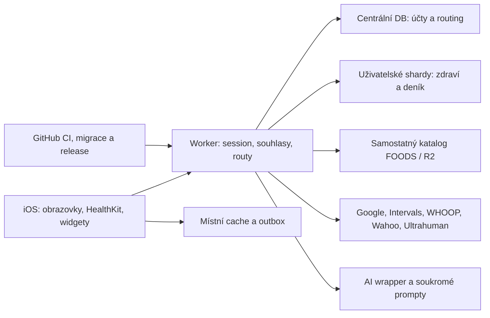

# Aurin — souhrnný audit aplikace

**Datum:** 20. října 2026. **Revidovaný commit:** `02d575e570a179a5c156bcc9708877a2c18f3de8`. **Režim:** kontrola zdrojů a lokální ověření, bez změn aplikace či produkčních dat.

**Výsledek: 33 doložených nálezů — 4× P1, 26× P2, 3× P3.** Nejde o 33 zaznamenaných produkčních incidentů: report rozlišuje runtime reprodukci, staticky dosažitelný tok a neověřené provozní riziko.

**Doporučení před širším vydáním:** nejdřív uzavřít A01, A02, A10 a A12, které porušují oddělení nebo viditelnou volbu zpracování zdravotních dat. Ve stejném stabilizačním kroku opravit A03 a A15, aby aplikace nepotvrzovala neuložené záznamy a nepřepisovala plán po neúspěšném načtení.

Audit pokrývá dostupný backend, nativní klient, hlavní uživatelské toky, synchronizace, výpočty, testy a release infrastrukturu. Nepředstavuje spuštění každé funkce na telefonu ani formální důkaz správnosti každého algoritmu. U velkých modulů je uvedena hloubka kontroly; datové katalogy byly posuzovány strukturálně.

## Jak číst priority

- **P1:** opravit před širším vydáním — citlivá data nebo jejich vlastníkem požadované zastavení toku.
- **P2:** konkrétní funkční, datová či bezpečnostní chyba — naplánovat opravu a regresní test.
- **P3:** omezený dopad, zavádějící UI/návod nebo zveřejněná osobní metadata.

Žádná úroveň priority sama nevyjadřuje pravděpodobnost v produkci. U reprodukcí bylo okolí funkcí místy izolované; skutečná externí API a iOS frameworky se nepředstírají jako otestované.

## Přehled všech nálezů

| ID | Priorita | Oblast | Co opravit |
|---|---|---|---|
| A01 | **P1** | Účty a soukromí | HealthKit po expiraci přihlášení pokračuje do dalšího účtu |
| A02 | **P1** | Účty a soukromí | Nový účet může odeslat čekající zápisy předchozího účtu |
| A03 | **P2** | Ukládání dat | Server potvrzuje zápis ještě před jeho skutečným dokončením |
| A04 | **P2** | Přihlášení a propojení | OAuth callback nepřipíná propojení k původnímu účtu |
| A05 | **P2** | Přihlášení a propojení | Použitý Google ticket obnoví odvolané přihlášení |
| A06 | **P2** | Posilovna | Starší úprava cviku přepíše později dokončenou sérii |
| A07 | **P2** | Tréninkové výpočty | Běžecký limit přidává běhy i při vyčerpaném rozpočtu |
| A08 | **P2** | Tréninkové výpočty | Dnešní plánovaný běh se neodečte z týdenního rozpočtu |
| A09 | **P2** | Notifikace | Push kouče se neplánuje pro účty bez Google nebo Intervals |
| A10 | **P1** | Účty a soukromí | Cyklus předchozího účtu zůstává viditelný po odhlášení |
| A11 | **P2** | Účty a soukromí | Apple Health export přenáší preference mezi účty |
| A12 | **P1** | Souhlasy a nastavení | Vypnutí všech kategorií Apple Health nezastaví čtení |
| A13 | **P2** | Kouč a UX | Chyba potvrzení návrhu odstraní možnost opakování |
| A14 | **P2** | Deník | Přepnutí dne dovoluje zapisovat podle starých odpovědí |
| A15 | **P2** | Posilovna | Selhání načtení gymu může automaticky přepsat uložený trénink |
| A16 | **P2** | Synchronizace aktivit | Wahoo synchronizace vrací ručně opravený typ a kalorie |
| A17 | **P2** | Tréninkové výpočty | Desetinné intenzity se v mezerách zón označí jako sprint |
| A18 | **P2** | Plány a šablony | Upravená vlastní šablona mění detail starších plánů |
| A19 | **P2** | Regenerace a zdroje | Wahoo aktivita chybí ve svalové únavě a regeneraci |
| A20 | **P2** | Zdravotní výpočty | Dnes a Zdraví počítají jiný spánkový dluh |
| A21 | **P2** | Čas a zdravotní data | Vážení se při UTC půlnoci přiřadí špatnému dni |
| A22 | **P2** | Synchronizace aktivit | Rozpracovaná Google operace je označená jako odeslaná aktivita |
| A23 | **P2** | Synchronizace aktivit | Smazaná aktivita Intervals zůstává v aplikaci |
| A24 | **P2** | Synchronizace výživy | Prázdné HealthKit čtení smaže importované jídlo a pití |
| A25 | **P2** | Bezpečnost a dostupnost | Jeden účet vyčerpá společný rozpočet přihlašovacích e-mailů |
| A26 | **P2** | Registrace a kapacita | Dvě registrace získají poslední volné místo |
| A27 | **P2** | Výživa a čas | Google export nahradí zadaný čas jídla polednem UTC |
| A28 | **P2** | Ukládání výživy | Hromadná změna jídel selže po částečném uložení |
| A29 | **P2** | CI a provoz | Workflow mikroživin selže před sestavením katalogu |
| A30 | **P3** | Web a produktový návod | Návod slibuje nedostupné odpojení přihlášení Apple |
| A31 | **P3** | Výživa a UX | Neúspěšné smazání receptu vypadá jako úspěšné |
| A32 | **P3** | Veřejná metadata | Osobní adresa majitele zůstává v historické migraci |
| A33 | **P2** | Cyklus a historie | Záznam užité pilulky v minulém dni se po uložení nezobrazí |

## Rozsah aplikace a důvěryhodnost výsledků

Základ inventáře: **236 backendových JS modulů**, **212 Swift souborů včetně testů**, **240 backendových testových souborů**, **10 workflow**, databázové migrace, servisní skripty a metadata assetů. Původní technický inventář obsahuje 916 vybraných textových souborů; není to tvrzení, že všech 150 tisíc řádků bylo individuálně validováno.

Aktuální sloučené pokrytí je v [POKRYTI.md](./POKRYTI.md). Úrovně se nesčítají s runtime testy; soubor může být přehledově čtený a zároveň mít jednu konkrétní runtime reprodukci.

| Oblast | Dostupné soubory | S revidovaným zdrojem/tokem |
|---|---:|---:|
| Backend JS | 236 | 236 |
| Swift včetně nativních testů | 212 | 212 |
| Servisní MJS skripty | 20 | 20 |
| GitHub workflow | 10 | 10 |
| SQL migrace a bootstrap | 33 | 33 |

Architektura, jejíž hranice byly prověřovány:

Důležité odlišení: serverové filtrování podle účtu může být správné, a přesto klient odešle data nesprávného vlastníka pod novou session. Proto report kontroluje i vznik požadavku, stav lokálních dat a pořadí asynchronních operací.

## Konkrétní nálezy a opravy

### A01 · P1 · HealthKit po expiraci přihlášení pokračuje do dalšího účtu

**Místo:** [ios-native/Loadwise/App/AppModel.swift:1384](../../ios-native/Loadwise/App/AppModel.swift#L1384).

**Příčina:** Při signOut(expired:true) se import Apple Health nepozastaví. Ani přihlášení jiného účtu jej nevypne; AppleHealth.run ověřuje existenci session, nikoli vlastníka povolení.

**Scénář a dopad:** A povolí HealthKit, jeho přihlášení vyprší a na stejném telefonu se přihlásí B s obecným zdravotním souhlasem. Další sync může uložit zdravotní data telefonu pod B bez zapnutí tohoto propojení pro B.

**Co opravit:** Vázat import na ID účtu a server, pozastavit jej při ztrátě identity, invalidovat rozpracovanou úlohu a před každým uploadem ověřit generaci účtu. Pouhé pause nestačí pro již běžící collect.

**Hotovo až když:** A→401→B: žádný upload A pod B; zopakovat změnu účtu během zadrženého reader.collect.

**Ověření:** Statická analýza celého toku; iOS runtime nebyl dostupný. Podrobný podklad: [REVIZE.md](./REVIZE.md).

### A02 · P1 · Nový účet může odeslat čekající zápisy předchozího účtu

**Místo:** [ios-native/Loadwise/App/AppModel.swift:370](../../ios-native/Loadwise/App/AppModel.swift#L370).

**Příčina:** signedIn zveřejní stav signedIn před await api.account a před kontrolou změny vlastníka. Today task mezitím spouští sendOutbox. Souběžný loadAccountInitial navíc může přepsat porovnávanou uloženou identitu.

**Scénář a dopad:** Jídlo, pití nebo vážení zachované po expiraci A mohou při přihlášení B odejít s cookie B. Jde o závod na témže telefonu, nikoli anonymní přístup k libovolnému účtu.

**Co opravit:** Nejprve ověřit identitu a vyměnit místní stav, potom zpřístupnit obrazovky a automatické zápisy. Každou položku outboxu označit vlastníkem a serverem a kontrolovat je před odesláním.

**Hotovo až když:** Zadržet první /me, pustit refresh Today a následně obrátit pořadí obou /me odpovědí; žádná položka A nesmí odejít pod B.

**Ověření:** Staticky potvrzená dosažitelná souběžná cesta; pořadí nebylo spuštěno v simulátoru. Podrobný podklad: [REVIZE.md](./REVIZE.md).

### A03 · P2 · Server potvrzuje zápis ještě před jeho skutečným dokončením

**Místo:** [src/idempotency.js:49](../../src/idempotency.js#L49).

**Příčina:** Opakování requestId během prvního pokusu dostane 200 s duplicate:true. Původní pokus může poté selhat; klient přitom po 2 xx záznam odstraní z outboxu.

**Scénář a dopad:** Timeout a retry mohou ztratit jídlo, pití nebo vážení pod falešným potvrzením úspěchu. Reprodukce: první odpověď 500, opakování 200, nula zápisů a nula claims.

**Co opravit:** Rozlišit pending a dokončený stav; pending nesmí být potvrzeným úspěchem. Upravit také klienta: samotný 409/425 by dnes většinou zahodil. Retry pending nesmí vyčerpat limit skutečných selhání.

**Hotovo až když:** Souběžné opakování a pozdější selhání prvního pokusu zachová položku k bezpečnému retry; úspěšné dokončení uloží právě jeden záznam.

**Ověření:** Runtime: repro-idempotency.mjs, původní funkce a skutečné lokální SQLite. Podrobný podklad: [REVIZE.md](./REVIZE.md).

### A04 · P2 · OAuth callback nepřipíná propojení k původnímu účtu

**Místo:** [src/google-oauth.js:20](../../src/google-oauth.js#L20).

**Příčina:** State cookie obsahuje náhodný state a návratový cíl, ale ne identitu iniciátora. Klíče callback uloží pod aktuální env.USER_ID.

**Scénář a dopad:** Při změně platné Aurin browser session A→B během autorizace se zdravotní zdroj A uloží B. Nativní connect ticket identitu ověřuje na začátku, ne při pozdějším callbacku.

**Co opravit:** Jednorázový serverový OAuth challenge vázaný na user_id, providera a expiraci. Nesouhlasící aktuální účet odmítnout před výměnou či uložením klíčů; sjednotit všechny providery.

**Hotovo až když:** Start UID 11, platný state, callback pod UID 22: žádné credentials pro 22 a srozumitelný návrat do app.

**Ověření:** Runtime: repro-auth.mjs s původními moduly ve VM a izolovanou DB/sítí; Google cesta, bez reálného browser přepnutí. Podrobný podklad: [REVIZE.md](./REVIZE.md).

### A05 · P2 · Použitý Google ticket obnoví odvolané přihlášení

**Místo:** [src/google-login.js:138](../../src/google-login.js#L138).

**Příčina:** Pětiminutový app handoff není jednorázový ani vázaný na epochu při vydání. Každá výměna vystaví session s aktuální epochou z DB.

**Scénář a dopad:** Držitel ticketu i verifieru je během zbývajících pěti minut znovu použije po odhlášení všech zařízení a získá platnou novou session. Nález neposkytuje způsob získání těchto dvou hodnot.

**Co opravit:** Ticket atomicky spotřebovat a ověřovat epochu z okamžiku vydání, obdobně jako jednorázové connect tickets.

**Hotovo až když:** Opakovaná výměna po prvním použití i po zvýšení epochy musí selhat; původní nepoužitá platná výměna funguje.

**Ověření:** Runtime: repro-auth.mjs; opakovaná výměna po epoch 0→1 vrátila 200 a platnou epoch 1. Podrobný podklad: [REVIZE.md](./REVIZE.md).

### A06 · P2 · Starší úprava cviku přepíše později dokončenou sérii

**Místo:** [ios-native/Loadwise/Screens/TrainingModeView.swift:976](../../ios-native/Loadwise/Screens/TrainingModeView.swift#L976).

**Příčina:** saveEdited/add zveřejní nový day, čeká na loadMuscles a teprve potom uloží zachycený starší snapshot. Mezitím je možné dokončit sérii.

**Scénář a dopad:** Později došlý starší snapshot přepíše nově hotovou sérii na serveru i v cache, zatímco obrazovka ji může stále ukazovat jako hotovou.

**Co opravit:** Zařadit změnu dne k uložení před čekáním na metadata; metadata načítat nezávisle. Zvážit revizi snapshotu, aby pozdní starý obsah nevyhrál.

**Hotovo až když:** Zpozdit gymMuscles, přidat cvik a dokončit jeho sérii; po dokončení odpovědi a reloadu série zůstává hotová.

**Ověření:** Statická analýza; AppModel serializaci ověřeno, že nechrání stáří později předaného obsahu. Podrobný podklad: [REVIZE.md](./REVIZE.md).

### A07 · P2 · Běžecký limit přidává běhy i při vyčerpaném rozpočtu

**Místo:** [src/week-planner.js:342](../../src/week-planner.js#L342).

**Příčina:** capRunVolume při škálování vynucuje minimálně 20 min každému návrhu, i když už nezbývá žádný týdenní rozpočet.

**Scénář a dopad:** Začátečník dostane 80 min při limitu 60; po dnešním dokončeném 60 min běhu může návrh přidat dalších 60 min a vrátit limited:true.

**Co opravit:** Omezit také počet běhů. Pokud rozpočet nestačí na minimální délku, běh nenavrhovat; po zaokrouhlení kontrolovat součet.

**Hotovo až když:** Nulový zbytek nevytvoří další běh, čtyři vybrané dny nepřekročí cap a existující hotové běhy zůstanou započítané.

**Ověření:** Runtime: repro-domain.mjs, původní weekProposal ve VM, bez CTL a AI. Podrobný podklad: [REVIZE.md](./REVIZE.md).

### A08 · P2 · Dnešní plánovaný běh se neodečte z týdenního rozpočtu

**Místo:** [src/adaptive-week.js:145](../../src/adaptive-week.js#L145).

**Příčina:** runCommitted bere plánované aktivity jen při date>today. Stejné pravidlo má entrypoint.js:727.

**Scénář a dopad:** Dnešní dosud neodběhnutý plán 60 min a další dvě budoucí možnosti vytvoří dalších 60 min při cap 60; odpověď chybně uvádí committed 0 a limited:false.

**Co opravit:** Započítat hotové běhy i dosud nedokončené plány od dneška včetně. Deduplikovat již dokončený plán; sjednotit oba výpočty.

**Hotovo až když:** Dnešní plán spotřebuje rozpočet, dokončení jeho spárované aktivity jej nespotřebuje podruhé.

**Ověření:** Runtime: repro-domain.mjs přes původní návrh týdne; dosažitelné POST /app/api/coach/week. Podrobný podklad: [REVIZE.md](./REVIZE.md).

### A09 · P2 · Push kouče se neplánuje pro účty bez Google nebo Intervals

**Místo:** [src/entrypoint.js:252](../../src/entrypoint.js#L252).

**Příčina:** Jediné plánované volání coachPush je v jobu sync s providery google/intervals. WHOOP/Ultrahuman/Apple-only účty se do něj nevyberou.

**Scénář a dopad:** Zapnuté notifikace a zařízení nestačí. Apple upload umí samostatně ranní připravenost, ale ne coachPush ani spolehlivý plánovaný retry po selhání či mimo ranní okno.

**Co opravit:** Samostatný job oznámení vybírat podle aktivního účtu, souhlasu a zařízení, nezávisle na konkrétním zdravotním providerovi.

**Hotovo až když:** Provider matice Apple-only/WHOOP/Ultrahuman/Google/Intervals má shodné oprávněné notifikační chování a zachová deduplikaci.

**Ověření:** Runtime výběru původních definic jobů: repro-push-selection.mjs; APNs doručení neověřeno. Podrobný podklad: [REVIZE.md](./REVIZE.md).

### A10 · P1 · Cyklus předchozího účtu zůstává viditelný po odhlášení

**Místo:** [ios-native/Loadwise/App/AppModel.swift:1377](../../ios-native/Loadwise/App/AppModel.swift#L1377).

**Příčina:** clearLocal nemaže cycle a cycleHealthSynced. Health i nastavení cyklu při nenulové hodnotě přeskakují nové načtení; loadCycle při chybě ponechá starý objekt.

**Scénář a dopad:** Po běžném logout A a login B se při nedostupném /cycle mohou zobrazit menstruace a antikoncepce A. Zachovaný pill stav může znovu naplánovat i jeho připomínky.

**Co opravit:** Resetovat veškerý cyklový stav i uložené pill reminders při změně identity. Loadery vázat na generaci účtu a serveru a ignorovat opožděné odpovědi.

**Hotovo až když:** A s cyklem→logout→B, /cycle 503: žádný cyklus ani připomínka A v Health/nastavení/notifications. Zopakovat opožděnou odpověď A.

**Ověření:** Statická analýza resetu, loaderů, UI a Reminders; bez iOS runtime. Podrobný podklad: [ios-jadro.md](./ios-jadro.md).

### A11 · P2 · Apple Health export přenáší preference mezi účty

**Místo:** [ios-native/Loadwise/App/AppleHealthExport.swift:23](../../ios-native/Loadwise/App/AppleHealthExport.swift#L23).

**Příčina:** prefs i written ledger mají globální UserDefaults klíče bez účtu/serveru. Logout je neresetuje; Food automaticky exportuje podle těchto lokálních přepínačů.

**Scénář a dopad:** B může po odhlášení A exportovat vlastní výživu do HealthKit, i když tento export nezapnul nebo má serverovou volbu off. Lokální nenulové preference mohou serverovou off přebít.

**Co opravit:** Oddělit preference a ledger podle ID účtu/serveru. Export po změně identity povolit až po ověřeném načtení jeho vlastních voleb; chránit i běžící operace.

**Hotovo až když:** A nutritionON→logout→B nutritionOFF→Food: žádný HealthKit write. Ověřit live/staging a zápis již rozpracovaný A.

**Ověření:** Staticky trasovaný export a SyncViews; fyzický zápis do HealthKit nebyl proveden. Podrobný podklad: [ios-jadro.md](./ios-jadro.md).

### A12 · P1 · Vypnutí všech kategorií Apple Health nezastaví čtení

**Místo:** [ios-native/Loadwise/Screens/AppleHealthViews.swift:118](../../ios-native/Loadwise/Screens/AppleHealthViews.swift#L118).

**Příčina:** onChange ignoruje prázdný výběr, aniž změní health.categories, enabled nebo observers. AppleHealth.update prázdný výběr také odmítá.

**Scénář a dopad:** UI zobrazuje všechny typy vypnuté, ale další sync dál čte a odesílá poslední povolené kategorie. Týká se i vypnutí poslední jednotlivé kategorie.

**Co opravit:** Prázdný výběr musí znamenat skutečné pozastavení a invalidaci běžícího uploadu, nebo UI musí poslední vypnutí s vysvětlením odmítnout. Restart nesmí prázdný výběr převést na vše.

**Hotovo až když:** VšeON→všeOFF a poslední typOFF: žádný další collect/upload ani po restartu a background wake.

**Ověření:** Statická analýza vazby UI→model→collect; skutečné HealthKit oprávnění nebylo měněno. Podrobný podklad: [ios-zdravi-vyziva.md](./ios-zdravi-vyziva.md).

### A13 · P2 · Chyba potvrzení návrhu odstraní možnost opakování

**Místo:** [ios-native/Loadwise/Screens/CoachView.swift:312](../../ios-native/Loadwise/Screens/CoachView.swift#L312).

**Příčina:** catch uloží chybu do bubble.decided stejně jako úspěch. ActionCard potom odstraní Potvrdit/Ne a zobrazí chybu zeleně.

**Scénář a dopad:** Při offline nebo 503 před provedením akce zůstane návrh neprovedený, ale uživatel jej nemůže znovu potvrdit na téže kartě.

**Co opravit:** Oddělit failed od decided, zachovat retry a stejné draftId. Úspěšné rozhodnutí zobrazit až po potvrzení serverem.

**Hotovo až když:** Offline a 503 zachovají možnost retry; následná úspěšná výměna provede změnu právě jednou.

**Ověření:** Statické trasování UI a API; bez simulátoru. Podrobný podklad: [ios-trenink.md](./ios-trenink.md).

### A14 · P2 · Přepnutí dne dovoluje zapisovat podle starých odpovědí

**Místo:** [ios-native/Loadwise/Screens/JournalViews.swift:367](../../ios-native/Loadwise/Screens/JournalViews.swift#L367).

**Příčina:** Přepnutí date ponechá starý day a aktivní ovládací prvky. Při pomalém či neúspěšném GET se používá stará odpověď, ale setAnswer posílá nové datum.

**Scénář a dopad:** Hlavička ukazuje úterý s pondělními odpověďmi. Klepnutí může změnit nebo smazat úterní hodnotu podle pondělního stavu.

**Co opravit:** Vyžadovat shodu day.date a otevřeného data, jinak editor blokovat nebo použít odpovídající cache. Také návrat POST/GET ověřit proti zachycenému datu a generaci.

**Hotovo až když:** Zadržet GET nového dne a POST starého dne; obrácené dokončení odpovědí nesmí ukázat či změnit nesprávný den.

**Ověření:** Staticky trasováno přes API až do backendového zápisu podle body.date. Podrobný podklad: [ios-zdravi-vyziva.md](./ios-zdravi-vyziva.md).

### A15 · P2 · Selhání načtení gymu může automaticky přepsat uložený trénink

**Místo:** [ios-native/Loadwise/Screens/GymLive.swift:324](../../ios-native/Loadwise/Screens/GymLive.swift#L324).

**Příčina:** LiveGymView potlačí chybu gymDay přes try?, vytvoří nový den a automaticky persistuje fallback. Také GET 200 se status:partial a values:[] klient vyhodnotí jako prázdný platný den.

**Scénář a dopad:** Při existujícím plánu/sériích, prázdné cache a dočasném GET 503 může následující úspěšný POST přepsat plán i odstranit zaznamenané série. Dosažitelná cesta je Zopakovat minulou.

**Co opravit:** Odlišit nenalezený a nenačtený den. Failed/partial odpověď nesmí vyvolat autosave. Zachovat status v DTO a přidat revision/conditional save.

**Hotovo až když:** Existující dokončená série + prázdná cache + GET 503 nebopartial 200: otevření obrazovky nesmí vyvolat zápis ani změnit uložená data.

**Ověření:** Staticky trasovaný UI→API→routes-gym zápis; simulátor nebyl použit. Podrobný podklad: [ios-trenink.md](./ios-trenink.md).

### A16 · P2 · Wahoo synchronizace vrací ručně opravený typ a kalorie

**Místo:** [src/wahoo.js:188](../../src/wahoo.js#L188).

**Příčina:** Wahoo upsert nahradí celý payload_json a nezachová lokální marker opraveného typu ani loadwiseKcal.

**Scénář a dopad:** Aktivita upravená na Walk/250 kcal se po webhooku nebo pravidelném syncu vrátí na Run/600 kcal. Uživatelská oprava se ztratí.

**Co opravit:** Oddělit provider data od uživatelských overrides, případně upsertovat s explicitním zachováním lokálních polí jako u jiných zdrojů.

**Hotovo až když:** Upravit typ/kalorie, provést opakovaný stejný i změněný import a zachovat lokální overrides bez dvojí aktivity.

**Ověření:** Runtime: repro-wahoo-overrides.mjs s původními editacemi, Wahoo SQL a SQLite. Podrobný podklad: [backend-domena.md](./backend-domena.md).

### A17 · P2 · Desetinné intenzity se v mezerách zón označí jako sprint

**Místo:** [src/workout-model.js:39](../../src/workout-model.js#L39).

**Příčina:** Zóny jsou celočíselná uzavřená pásma s mezerami, ale průměr předepsané intenzity je desetinný. Fallback pro nenalezenou zónu vrací poslední pásmo sprint.

**Scénář a dopad:** Platných 75.5 % FTP nebo 77.5 % běžeckého prahu dostane 30 min sprintu a chybnou klasifikaci typu/intenzity tréninku.

**Co opravit:** Použít spojité intervaly nebo konzistentní dokumentované zaokrouhlení před lookupem. Extrémy a neplatné vstupy řešit explicitně.

**Hotovo až když:** Hraniční a desetinné hodnoty ve všech zónách obou sportů, včetně midpointu rampy, nesmí propadnout do sprintu.

**Ověření:** Runtime: repro-zone-gaps.mjs, původní template→structure→library funkce. Podrobný podklad: [backend-domena.md](./backend-domena.md).

### A18 · P2 · Upravená vlastní šablona mění detail starších plánů

**Místo:** [src/workout-templates.js:210](../../src/workout-templates.js#L210).

**Příčina:** Nové naplánování přepíše jedinou saved_workouts.structure_json. Starší schedule links mají stejné own-ID a getWorkout znovu čte aktuální šablonu.

**Scénář a dopad:** Pondělní plán 30 min po úpravě šablony na 90 min a naplánování čtvrtka ukazuje v detailu 90 min, přestože jeho kalendář/export zůstal 30 min.

**Co opravit:** Uložit neměnný snapshot či verzi pro každý naplánovaný výskyt. Samostatně měnit šablonu pro budoucí použití a konkrétní kalendářní událost.

**Hotovo až když:** Úprava šablony a druhé naplánování nezmění starý detail, export ani odhad zátěže.

**Ověření:** Runtime: repro-own-workout-snapshot.mjs, původní link/getWorkout/ownLibraryWorkout a SQLite. Podrobný podklad: [backend-domena.md](./backend-domena.md).

### A19 · P2 · Wahoo aktivita chybí ve svalové únavě a regeneraci

**Místo:** [src/muscle-fatigue.js:337](../../src/muscle-fatigue.js#L337).

**Příčina:** loadTrainingDoses nepovoluje source_family=wahoo v obou SQL větvích dokončených aktivit, zatímco ostatní obrazovky Wahoo již podporují.

**Scénář a dopad:** Dlouhá jízda pouze z Wahoo může být v kalendáři, ale Svaly a doba regenerace ji nevidí. Reprodukce 180TSS: Wahoo 0 aktivit, totožné Intervals 1.

**Co opravit:** Doplnit Wahoo a sdílet matici podporovaných zdrojů s deduplikací; neschovávat výpočetní výpadek jako odpočaté svaly.

**Hotovo až když:** Každý provider dává stejnou dávku pro stejnou aktivitu; Wahoo+Apple kopie se započítá jednou.

**Ověření:** Runtime: repro-recovery.mjs s původním loaderem a SQLite. Podrobný podklad: [backend-recovery.md](./backend-recovery.md).

### A20 · P2 · Dnes a Zdraví počítají jiný spánkový dluh

**Místo:** [src/app-health.js:85](../../src/app-health.js#L85).

**Příčina:** Health předává do výpočtu pouze primaryNights bez zdřímnutí; Today předává všechny sessions a model nap započítává.

**Scénář a dopad:** Noc 7 h a nap 1 h při potřebě 8 h: Dnes dluh 0, Zdraví dluh 60 min. Rozdíl se může za více dní kumulovat.

**Co opravit:** Použít jednotný výpočet a stejné vstupy pro obě obrazovky; oddělit výběr hlavní noci pro detail od všech spánků pro dluh.

**Hotovo až když:** Stejná data s nocí, naps a split-night dávají shodný debt na Today a Health.

**Ověření:** Runtime: repro-recovery.mjs přes obě původní build funkce a skutečný recovery model. Podrobný podklad: [backend-recovery.md](./backend-recovery.md).

### A21 · P2 · Vážení se při UTC půlnoci přiřadí špatnému dni

**Místo:** [src/app-health.js:121](../../src/app-health.js#L121).

**Příčina:** Health a Today získávají den váhy přes timestamp.slice(0,10), místo uživatelovy lokální zóny.

**Scénář a dopad:** 2026-10-20T01:00Z je v New Yorku 19.října 21:00. Pro 19.října se poslední váha skryje jako budoucí a zobrazí se null nebo starší údaj.

**Co opravit:** Odvozovat den přes localDate a čas řadit chronologicky; stejnou funkci sdílet mezi obrazovkami.

**Hotovo až když:** UTC− i UTC+ zóny, časné/pozdní vážení a explicitní offset se zobrazí v odpovídajícím lokálním dni.

**Ověření:** Runtime: repro-recovery.mjs uvnitř skutečného withTimeZone. Podrobný podklad: [backend-recovery.md](./backend-recovery.md).

### A22 · P2 · Rozpracovaná Google operace je označená jako odeslaná aktivita

**Místo:** [src/sync-destinations.js:263](../../src/sync-destinations.js#L263).

**Příčina:** pushGoogle uloží operations/... z done:false jako remote_id a deliver označí sent. Operace se nepoluje; další editace nepovažuje toto ID za resource a udělá nový POST.

**Scénář a dopad:** Při úspěchu první operace může další odeslání stejného gym klíče vytvořit duplicitu. Při selhání operace UI stále tvrdilo, že odeslání proběhlo.

**Co opravit:** Oddělit operation ID a resource ID, uchovat pending stav a pollovat do done. Teprve potvrzený resource označit sent a pozdější revizi PATCHovat.

**Hotovo až když:** Pending→success/error a editace během operace: žádné předčasné sent, žádný druhý create stejného záznamu.

**Ověření:** Runtime: repro-google-exercise-operation.mjs, SQLite a simulovaná podporovaná LRO odpověď; četnost u reálného API neměřena. Podrobný podklad: [platform-connectors.md](./platform-connectors.md).

### A23 · P2 · Smazaná aktivita Intervals zůstává v aplikaci

**Místo:** [src/index.js:1199](../../src/index.js#L1199).

**Příčina:** syncIntervalsActivities jen upsertuje vrácené aktivity. ACTIVITY_DELETED webhook vyvolá stejný import, ale nepředá smazané ID a nic neodstraní.

**Scénář a dopad:** Po odstranění aktivity v Intervals zůstane starý řádek v Aurinu a může dál ovlivňovat kalendář, výživu a zátěž i po refreshi.

**Co opravit:** Zpracovat konkrétní deleted ID nebo bezpečně rekonciliovat úspěšně načtené úplné okno. Zachovat app-owned kopie a správně obnovit roli spárovaného watch záznamu.

**Hotovo až když:** Import→provider delete→webhook/refresh odstraní pouze odpovídající import; neúplná či chybná odpověď nesmí smazat okno.

**Ověření:** Runtime: repro-intervals-deleted-activity.mjs; po kompletním prázdném listu zůstala 1 smazaná aktivita. Podrobný podklad: [platform-connectors.md](./platform-connectors.md).

### A24 · P2 · Prázdné HealthKit čtení smaže importované jídlo a pití

**Místo:** [src/apple-food.js:127](../../src/apple-food.js#L127).

**Příčina:** Přítomné prázdné meals/drinks pole se chápe jako kompletní deletion window. Nativní reader je může poslat i po odnětí čtecího oprávnění bez chyby.

**Scénář a dopad:** Jedno importované jídlo a pití se při stejném okně s prázdnými poli obě odstraní. Prázdné čtení přitom samo neprokazuje uživatelské smazání.

**Co opravit:** Použít explicitní deleted IDs/anchored queries a příznak úplnosti. Neúplné či odmítnuté čtení nesmí být destruktivní okno; sladit ochrany se sleep/workout importem.

**Hotovo až když:** Ztráta read oprávnění a neúplné čtení zachovají historii; skutečné potvrzené deleted IDs smažou správné řádky.

**Ověření:** Backend runtime: repro-apple-food-empty.mjs a SQLite; odnětí oprávnění na zařízení nebylo provedeno. Podrobný podklad: [platform-connectors.md](./platform-connectors.md).

### A25 · P2 · Jeden účet vyčerpá společný rozpočet přihlašovacích e-mailů

**Místo:** [src/email-login.js:214](../../src/email-login.js#L214).

**Příčina:** Email-change/start nemá atomický per-user ani per-IP limit. Různé cílové adresy obcházejí cooldown adresy a open:false čerpá i rezervu pro přihlášení.

**Scénář a dopad:** Jeden přihlášený účet může při výchozí konfiguraci odeslat 500 kódů v jedné minutě a znemožnit další přihlašovací e-maily do resetu. Reprodukce skutečné e-maily neposílala.

**Co opravit:** Limitovat účet i zdrojovou síť, počet rozpracovaných adres a samostatný budget změny adres. Zachovat chráněnou kapacitu pro běžné přihlášení.

**Hotovo až když:** Rotace cílových adres narazí na limit účtu; jiný uživatel stále získá přihlašovací kód, i při paralelních požadavcích.

**Ověření:** Runtime: repro-email-change-budget.mjs, původní handler/limiter a SQLite, fake delivery. Podrobný podklad: [backend-platforma.md](./backend-platforma.md).

### A26 · P2 · Dvě registrace získají poslední volné místo

**Místo:** [src/tenancy.js:446](../../src/tenancy.js#L446).

**Příčina:** Kontrola kapacity SELECT a následný INSERT uživatele jsou oddělené. Dvě různě ověřené adresy mohou obě projít posledním místem.

**Scénář a dopad:** Vzniknou dva účty při jednom místě. Allocator správně nepřeplní shard, ale druhý účet zůstane bez úložiště a API vrací 503 místo waitlistu.

**Co opravit:** Vznik účtu a rezervaci kapacity spojit atomicky v centrální DB; session pro plný účet vydat až po rezervaci. Přerušené rezervace musí být obnovitelné.

**Hotovo až když:** Při 1 volném místě vytvoří paralelní dokončení nejvýše 1 aktivní účet s route; ostatní deterministicky waitlist. Ověřit e-mail/Google/Apple.

**Ověření:** Runtime: repro-account-capacity-race.mjs, původní tenancy/allocator a SQLite. Podrobný podklad: [backend-platforma.md](./backend-platforma.md).

### A27 · P2 · Google export nahradí zadaný čas jídla polednem UTC

**Místo:** [src/food-google-sync.js:20](../../src/food-google-sync.js#L20).

**Příčina:** Export akceptuje čas jen s offsetem/Z, ale mealConsumedAt ukládá platný lokální čas bez offsetu. Ten se zamění za chybějící a dostane 12:00Z.

**Scénář a dopad:** Snídaně 07:30 se exportuje jako 12:00UTC, v Praze například 14:00. Kalorie zůstanou, časová historie je nesprávná.

**Co opravit:** Rozlišit lokální známý čas a neznámý čas, převádět přes uživatelovu zónu s DST a zachovat offset.

**Hotovo až když:** Lokální 07:30, UTC, explicitníoffset a změna letního času se převedou správně; fallback jen při skutečně chybějícím čase.

**Ověření:** Runtime: repro-food-audit.mjs nad původní foodGooglePayload. Podrobný podklad: [vyziva-web-provoz.md](./vyziva-web-provoz.md).

### A28 · P2 · Hromadná změna jídel selže po částečném uložení

**Místo:** [src/food-entry-management.js:101](../../src/food-entry-management.js#L101).

**Příčina:** Bulk změny se provádějí postupně bez transakce. Chybějící další položka vyvolá chybu celého endpointu až po uložení předchozích; export queue se připravuje později.

**Scénář a dopad:** Druhé jídlo smazané jiným zařízením způsobí chybu, přestože první už bylo zkopírované. Retry vytvoří další kopii a některé změny mohou zůstat bez Google exportu.

**Co opravit:** Předvalidovat všechny vstupy a lokální změny atomicky uložit, nebo explicitně vracet a zpracovat částečné výsledky. Kopírování chránit requestId.

**Hotovo až když:** Chybějící druhé ID a fail prostředního zápisu nezanechají neoznámené změny; retry stejné dávky neduplikuje první položku.

**Ověření:** Runtime: repro-food-audit.mjs a SQLite; první pokus 1 kopie+chyba, retry 2 kopie+chyba. Podrobný podklad: [vyziva-web-provoz.md](./vyziva-web-provoz.md).

### A29 · P2 · Workflow mikroživin selže před sestavením katalogu

**Místo:** [.github/workflows/food-micros.yml:54](../../.github/workflows/food-micros.yml#L54).

**Příčina:** Workflow spouští testy importující private/lang.js, ale nestahuje soukromý repozitář, který je gitignored.

**Scénář a dopad:** Čistý GitHub runner skončí na ERR_MODULE_NOT_FOUND před buildem a požadovaným uploadem mikroživin.

**Co opravit:** Doplnit ověřený checkout závislosti, případně oddělit základní lokalizaci od AI promptů, aby datový build soukromé texty nepotřeboval.

**Hotovo až když:** Přesný workflow příkaz z čistého checkoutu projde a vytvoří dry-run artefakt bez uploadu; testy nepřeskakovat.

**Ověření:** Přesný test příkaz zopakován lokálně: food-workflow-tests.tap; vzdálený workflow nebyl spuštěn. Podrobný podklad: [vyziva-web-provoz.md](./vyziva-web-provoz.md).

### A30 · P3 · Návod slibuje nedostupné odpojení přihlášení Apple

**Místo:** [src/site-pages.js:764](../../src/site-pages.js#L764).

**Příčina:** EN i CS text odkazují na unlink Apple v Nastavení→Účet. Swift UI nemá příslušný caller a endpoint /app/api/me/apple je owner-only.

**Scénář a dopad:** Běžný uživatel nenajde popsaný postup. Externí možnost v Apple ID settings zůstává v textu uvedená; nejde samo o zranitelnost přihlášení.

**Co opravit:** Implementovat bezpečnou uživatelskou cestu s kontrolou alternativního přihlášení, nebo opravit obě jazykové verze návodu podle reálné aplikace.

**Hotovo až když:** Ne-owner účet může provést přesně popsané kroky a neztratí jediný funkční způsob přihlášení.

**Ověření:** Statické porovnání webového textu, UI callerů a owner-only pravidla. Podrobný podklad: [vyziva-web-provoz.md](./vyziva-web-provoz.md).

### A31 · P3 · Neúspěšné smazání receptu vypadá jako úspěšné

**Místo:** [ios-native/Loadwise/Screens/AddFoodSheet.swift:271](../../ios-native/Loadwise/Screens/AddFoodSheet.swift#L271).

**Příčina:** Kontextová akce ignoruje chybu deleteRecipe přes try? a recept vždy odstraní z místního seznamu. Trvalý delete outbox zde není.

**Scénář a dopad:** Při offline/500 položka zmizí bez chyby, ale server ji zachová a další načtení nebo zařízení ji vrátí.

**Co opravit:** Měnit seznam až po úspěchu, nebo zavést optimistický stav s rollbackem/chybou či trvalou frontou smazání.

**Hotovo až když:** Odmítnutý DELETE nesmí být vykreslen jako hotové smazání a musí umožnit opakování.

**Ověření:** Statická analýza konkrétního UI delete toku. Podrobný podklad: [ios-zdravi-vyziva.md](./ios-zdravi-vyziva.md).

### A32 · P3 · Osobní adresa majitele zůstává v historické migraci

**Místo:** [migrations/0004_backfill_completed_strength_20261002.sql:15](../../migrations/0004_backfill_completed_strength_20261002.sql#L15).

**Příčina:** Přes přesun OWNER_EMAIL do secretu současný veřejný SQL backfill stále obsahuje konkrétní osobní identifikátor. Hodnotu report neopakuje.

**Scénář a dopad:** Repozitář dál zveřejňuje identifikaci účtu v rozporu s cílem odstranění adresy z kódu. Jde o osobní metadata, nikoli heslo či API klíč.

**Co opravit:** Posoudit potřebnost historického backfillu pro nové databáze a odstranit konkrétní identifikátor z aktuální publikované verze. Případnou změnu Git historie řešit samostatně, bez automatického přepisování.

**Hotovo až když:** Kontrola publikovaného aktuálního stromu nenajde osobní OWNER_EMAIL v konfiguračních/datových migracích; bootstrap zůstane funkční.

**Ověření:** Statická kontrola aktuálního SQL; bez čtení tajných hodnot či změn historie. Podrobný podklad: [provoz.md](./provoz.md).

### A33 · P2 · Záznam užité pilulky v minulém dni se po uložení nezobrazí

**Místo:** [src/cycle-model.js:79](../../src/cycle-model.js#L79).

**Příčina:** Store převede pill:true na kanonický řetězec taken. Při čtení normalizeCycleDay připouští pouze boolean true nebo čas HH:MM, takže vlastní uložený řetězec převede na null.

**Scénář a dopad:** Nativní formulář pro minulý den skutečně posílá true. Užití zůstane fyzicky v DB jako taken, ale odpověď, nové načtení i kalendář je ukážou jako nezaznamenané/plánované. Větev s časem HH:MM tímto konkrétním problémem netrpí.

**Co opravit:** Zachovat kanonické taken v normalizaci a sjednotit kontrakt save/read/calendar. Normalizátor musí být idempotentní pro vlastní výstup.

**Hotovo až když:** Save→list→calendar pro true, taken a HH:MM zachová užití i po znovuotevření; explicitní vymazání nadále funguje.

**Ověření:** Runtime: repro-cycle-pill.mjs s původním modelem/store a skutečným SQLite; stored:taken, response:null, loaded:null, calendar:planned. Nativní cesta staticky potvrzená. Podrobný podklad: [doplneni-pokryti.md](./doplneni-pokryti.md).

## Průřezové technické problémy a další ověření

Následující body nejsou další samostatně počítané potvrzené chyby. Některé mají podmíněný scénář, jiné popisují chybějící ověření provozu.

| Téma | Co je potřeba změnit nebo doložit |
|---|---|
| Vlastnictví stavu v klientovi | Sjednotit tabulku device / account+server / session dat; zavést generation guard a společný reset. Globální preference nejsou automaticky špatně, ale per-account data nesmějí být bez vlastníka. |
| Stavové automaty zápisů | Sjednotit pending/succeeded/failed/unknown; nedělat z chyby prázdný validní model nebo potvrzený úspěch. Retry musí být bezpečný i při ztracené odpovědi. |
| Historie a uživatelské opravy | Oddělit provider payload od vlastních overrides a šablonu od neměnného naplánovaného výskytu. |
| Shoda stejných metrik | Sjednotit lokální datum, výběr providerů a výpočet debt mezi obrazovkami; přidat kontraktovou matici stejných dat. |
| AI a modely | Otestovat veřejné validátory s reálnými soukromými instrukcemi, prompt injection a nejednoznačnými akcemi. Zdokumentované heuristiky nebyly empiricky validovány na populaci sportovců. |
| Reprodukovatelnost releasu | Test a deploy znovu získávají nepinované prompty. Určit a zaznamenat SHA obou repozitářů jednou pro celý release i rollback. |
| Zálohy a obnova | Repo backup plán pokrývá core+20shardů, nikoli samostatnou FOODS DB. Doložit její obnovu a provést izolovaný restore drill včetně routing a počtů; reálné RPO/RTO nebyly změřeny. |
| Publikace R2 katalogů | Výchozí denní verze může při druhém buildu téhož dne přepsat stejné pack keys se starou cache indexů. Ověřit scénář a používat neměnný unikátní hash/verzi. |
| Kvalita CI | no-undef je úzký lint. Některé PR filtry nepokrývají samostatné scripts/migrations změny. Posílit kontraktové a souběhové regrese a čistý bootstrap na PR. |
| Vizuální testy | Generování PNG a kontrola existence nejsou porovnání s referencí ani automatický důkaz, že se text vejde. Doplnit vizuální regrese a ruční průchod. |
| UX selhání | Další try? v nastavení cyklu, deníku a favorites mohou skrývat chyby; sjednotit explicitní výsledek, rollback a retry. Rozlišovat unknown/off u souhlasů. |
| iOS systémové chování | Ověřit widget/app souběh nápojů, nedostatek místa, AlarmKit částečné selhání, zamknutý telefon, BT reconnect a force quit aktivního tréninku. |
| Přístupnost a jazyk | VoiceOver, největší text, Reduce Motion, nejmenší displej, CS/EN, 12/24h a imperiální jednotky vyžadují runtime průchod. Statické labels samy nedokazují použitelnost. |
| Platební cesta | Pilotní paywall s cenovými texty není ověření StoreKit nákupu, obnovy ani serverových notifikací předplatného. Skutečný transakční cyklus nebyl proveden. |
| Provozní nastavení | YAML neprokazuje skutečnou branch protection, schvalování prostředí, rozsahy tokenů, APNs a limity providerů. Potřebné je read-only provozní ověření těchto nastavení. |

## Co bylo skutečně spuštěno

| Kontrola | Výsledek a význam |
|---|---|
| Lint | Prošlo npm run lint; konfigurace vynucuje pouze no-undef. |
| Syntaxe veřejného JS a skriptů | Prošlo node --check pro dostupné src/*.js a scripts/*.mjs. |
| Standardní npm test / check | Blokuje chybějící src/private. Soukromé texty nebyly nahrazeny falešnými soubory. |
| Přímé spuštění testů | Výstup tests.tap:240položek,28úspěšných,212neúspěšných. Dominantní příčina je import chybějící private/lang.js; nejde o212potvrzených vad aplikace. |
| Lokální reprodukce | 15 skriptů, všechny návratový kód0. Původní relevantní funkce, místy VM/náhrada okolí; síť a doručení byly lokálně izolované. |
| Čistý SQL bootstrap | Skutečné SQLite: bootstrap + ledger10již-reflektovaných migrací +20dalších aplikovaných, shard marker i food schema prošly. Nejde o živou D1 migraci produkčních dat. |
| Datové katalogy cviků | Strukturálně ověřena shoda322českých/anglických technique a feel klíčů a přítomnost požadovaných polí. Nejde o odborné schválení všech cviků. |
| Nativní unit/UI testy | Zdrojové assertions a toky revidované; Xcode a iOS runtime nebyly dostupné, takže nebyly spuštěny. |

Použitý Node byl v24.19.0; CI deklaruje Node22. Izolované reprodukce nenahrazují plný Worker integration test na cílové verzi. Nebyly použity produkční účty, měněna HealthKit oprávnění, odesílány skutečné e-maily, nasazován kód ani uploadována data do R2.

## Doporučené pořadí oprav

| Krok | Rozsah | Kritérium dokončení |
|---|---|---|
| 1. Oddělení účtů a respektování voleb | A01,A02,A10,A12; ve stejném návrhu i A11 | Přepnutí účtu/serveru a všechnyOFF nemají cizí zobrazení, upload, export ani reminders; generace se kontroluje i po await. |
| 2. Spolehlivé zápisy | A03,A06,A15,A28,A31 | Žádné falešné úspěchy ani autosave po failedload; retry nepoškodí/nezduplikuje záznam. |
| 3. Autentizace a dostupnost | A04,A05,A25,A26 | Jednorázové a identity-bound challenge, chráněný emailpool, atomická registrace s místem. |
| 4. Import/export a historie | A16,A18,A22,A23,A24,A27 | Edity přetrvají, plány jsou neměnné snapshoty, remote lifecycle má pending/done/delete a úplnost čtení. |
| 5. Výpočty a běžné toky | A07,A08,A09,A13,A14,A17,A19,A20,A21,A33 | Shodné metriky a datum, skutečný run cap, správné zóny, retry kouče, správný deník/cyklus a notifikace všech providerů. |
| 6. Release a dokumentace | A29,A30,A32 a provozní rizika | Čistý build, přesná závislost promptů, ověřená obnova, aktuální návod a minimalizovaná osobní metadata. |

Velikost opravy závisí na zvoleném společném řešení. Jednotlivé opravy seskupit podle sdílené příčiny, ale zachovat samostatná regresní kritéria každého ID. Report záměrně nevymýšlí časový odhad bez návrhu implementace.

## Ověření před vydáním

1. Se zpřístupněnými skutečnými prompty spustit plnou sadu na Node22 a ve stagingu ověřit API kontrakty.
2. Na macOS spustit nativní testy a regresní scénáře přepnutí účtu/serveru během probíhajících požadavků.
3. Pro save/edit/delete/copy zkoušet offline, ztracenou odpověď, timeout,401,429,503 i částečný backend výsledek.
4. Přes podporované providery ověřit kompletní import→ruční oprava→resync→delete→export a obnovu po výpadku.
5. Překontrolovat stejné metriky a dny na Dnes/Zdraví/Jídlo/Trénink: naps, UTC±zóny, DST, kopie aktivit a běžecký rozpočet.
6. Projít reálný telefon, VoiceOver, velký text, CS/EN, témata, malé displeje, widgety, alarm a živý workout.
7. Izolovaně obnovit core/shards/FOODS ze záloh a ověřit routing, počty a přístup účtů.

## Podklady

- [POKRYTI.md](./POKRYTI.md) a [pokryti.csv](./pokryti.csv): skutečná hloubka kontroly podle souborů.
- [OPRAVY.csv](./OPRAVY.csv): seznam úkolů, priorit, míst a acceptance kritérií.
- [reprodukce-vysledky.json](./reprodukce-vysledky.json), [tests.tap](./tests.tap), [schema-verification.json](./schema-verification.json): uložené výsledky kontrol.

- [REVIZE.md](./REVIZE.md): podrobný dílčí podklad.
- [ios-jadro.md](./ios-jadro.md): podrobný dílčí podklad.
- [ios-zdravi-vyziva.md](./ios-zdravi-vyziva.md): podrobný dílčí podklad.
- [ios-trenink.md](./ios-trenink.md): podrobný dílčí podklad.
- [ios-design.md](./ios-design.md): podrobný dílčí podklad.
- [backend-domena.md](./backend-domena.md): podrobný dílčí podklad.
- [backend-recovery.md](./backend-recovery.md): podrobný dílčí podklad.
- [backend-platforma.md](./backend-platforma.md): podrobný dílčí podklad.
- [platform-connectors.md](./platform-connectors.md): podrobný dílčí podklad.
- [vyziva-web-provoz.md](./vyziva-web-provoz.md): podrobný dílčí podklad.
- [provoz.md](./provoz.md): podrobný dílčí podklad.
- [doplneni-pokryti.md](./doplneni-pokryti.md): podrobný dílčí podklad.

Report je seznamem konkrétních závad a provedené kontroly dostupných zdrojů. **Aplikační kód, repozitářová historie ani produkční data nebyly změněny.**
